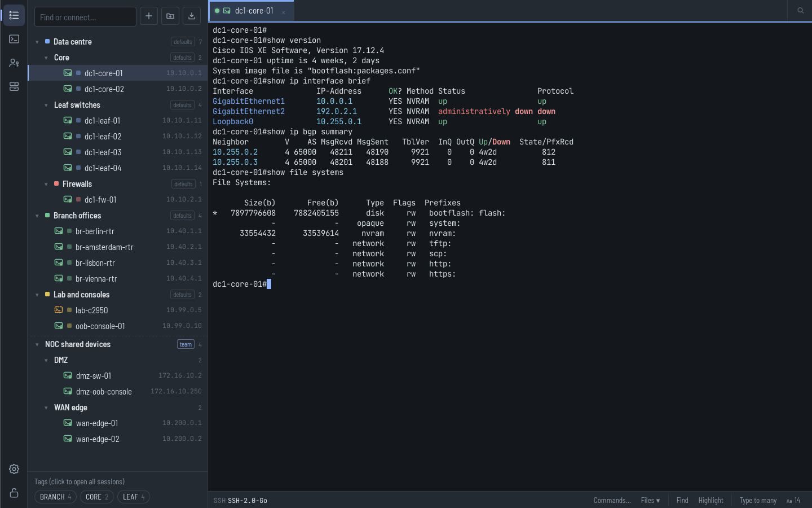
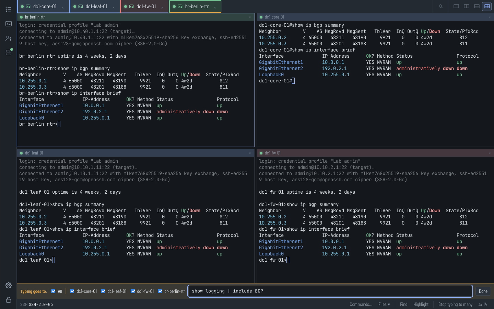
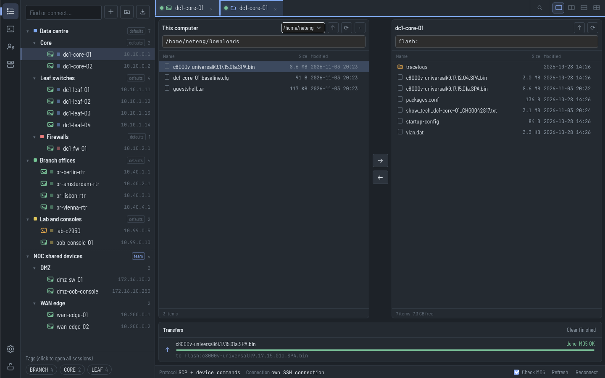
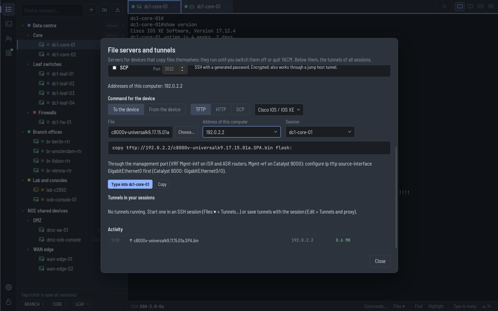
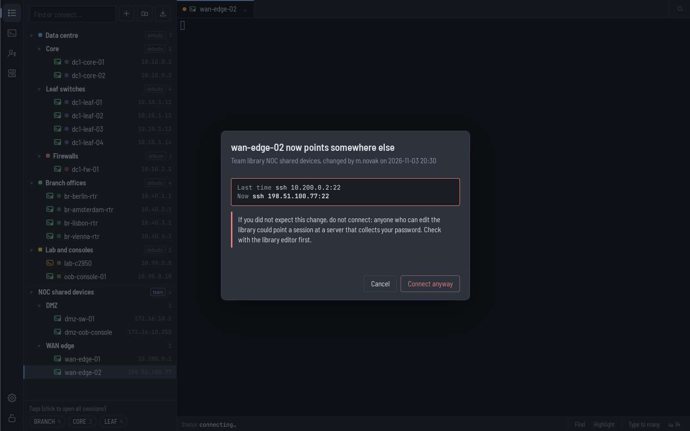

# YACM: Yet Another Connection Manager

A free, open-source SSH, telnet and serial console manager for network
engineers, built for teams that look after hundreds or thousands of devices.
One program for the newest and the oldest gear, on Windows, macOS and Linux.
Website: [yacm.app](https://yacm.app).

## Why YACM

- **Team libraries without shared passwords.** Publish a group of sessions as
  one file on a share or in git. Colleagues see the same devices, read-only,
  and log in with their own accounts. Changes show up within seconds, and
  when a session suddenly points somewhere else, YACM asks before it sends
  anyone's password.
- **Change a password or a bastion once.** Credential profiles and group
  defaults (login, jump host, SSH algorithms, colours) are inherited by every
  session below; when your directory password changes or a site moves behind
  a new bastion, you change one place.
- **Files through jump hosts, the way network devices need them.** Send and
  get files over the session's own SSH connection, through every jump host,
  with free-space and MD5 checks on Cisco, Arista, Juniper and Linux. And
  `show tech-support` goes straight into a file, typed into the session with
  its enable rights, `--More--` answered.
- **File servers that write the copy command.** TFTP, HTTP and SCP servers on
  your computer: YACM writes the `copy` command for IOS, IOS XE, NX-OS,
  IOS XR, EOS, Junos or Linux, types it into the session, and opens a reverse
  tunnel when the device sits behind a jump host (or a Linux server behind a
  VPN cannot connect back to you).
- **The newest and the oldest gear in one window.** Post-quantum SSH by
  default, algorithm profiles for old IOS, telnet, serial consoles with
  break, chains of jump hosts with MFA, and a host key check on every hop.
- **A terminal that knows networks.** Background tabs flag neighbours going
  down and err-disabled ports, sessions reconnect by themselves after a reload,
  anti-idle keeps the exec-timeout away without touching your command line,
  and interfaces, addresses and syslog messages are highlighted.
- **Made for regulated networks.** An encrypted vault that locks itself,
  session logs with secrets masked and named by change number, no
  telemetry, an SBOM and build provenance for every release. YACM helps you
  meet NIS2, ISO 27001 and PCI DSS
  ([details](docs/security-compliance.md)).
- **Switch in minutes.** Imports SecureCRT (with logon actions, credential
  sets and saved passwords), Xshell, MobaXterm, mRemoteNG, PuTTY, Ásbrú,
  `~/.ssh/config`, CSV and Excel lists, and NetBox.
- **Free, open and portable.** GPL-licensed; no installer, no administrator
  rights, no account. It even runs from a USB stick.

## Screenshots

| | |
|---|---|
|  |  |
| **Type to many** in a split view: one command to four devices. | **Files tab** on the session's own SSH connection, with the MD5 check. |
|  |  |
| **File servers** that write the `copy` command and type it into the session. | **Team libraries** ask before your login goes to a changed address. |

## Download

Get the latest version from [Releases](https://github.com/icavar/yacm/releases):

- **Windows** (10 and 11): unpack `yacm-*-windows-x64.zip` (most PCs) or
  `yacm-*-windows-arm64.zip` (Windows on ARM) and start `YACM.exe`. No
  installation and no administrator rights are needed. Until the Windows builds are signed, SmartScreen may
  ask: *More info > Run anyway*.
- **macOS** (13 or newer, Apple silicon and Intel): open `YACM-*-macos.dmg`
  and drag YACM to Applications. The app is signed and notarised.
- **Linux** (x64): unpack `yacm-*-linux-amd64.tar.gz` and start `./yacm`. It
  needs WebKitGTK 4.1 (`sudo apt install libwebkit2gtk-4.1-0` on Ubuntu 22.04
  and Debian 12 or newer) and adds itself to the application menu.

Every release has SHA-256 checksums, a software bill of materials and a
build provenance attestation for each file
(`gh attestation verify <file> --repo icavar/yacm`).

**First steps**: YACM asks for a master password for its vault, then offers
to import your sessions or add your team's library. To try it without
hardware, get the separate demo download for your system
(`yacm-*-demo-windows.zip`, `yacm-*-demo-macos.zip` or
`yacm-*-demo-linux-amd64.tar.gz`), start the demo device and import
`demo.yacm` (see the [user guide](docs/guide.md#trying-it-without-hardware)).

## Features

### Teams and large networks

- **Team libraries**: shared, read-only sessions with personal logins, live
  updates from a share, synced folder or git, editing with a lock and a
  revision check, and a warning when a session's target changes.
- **Credential profiles and group defaults**: logins, jump hosts, algorithm
  profiles and colours inherited through groups and subgroups.
- **Edit many sessions at once**: login, jump host, algorithms, port, group,
  tags, logging, colours and more for a selection or a whole group.
- **Find among thousands**: one field filters the tree and connects (also to
  addresses nothing saved has); *Go to session* ranks matches and remembers
  what you opened last. Tags, favourites and colours for production and lab.
- **Session logs for audits**: file names from a template with the group,
  host, date and the change or ticket number YACM asks for when connecting.
- **Import** from other programs, CSV and Excel lists and NetBox, with
  passwords moved into the vault ([details](docs/import-export.md)).

### Every device, every path

- **SSH** with Secure (post-quantum), Compatible and Legacy algorithm
  profiles; passwords, keyboard-interactive MFA, OpenSSH and PuTTY `.ppk`
  keys, user certificates and the SSH agent; `known_hosts` with host
  certificates.
- **Jump host chains**: any saved session can be the jump host of others;
  every hop checks its own host key. Telnet sessions can go through SSH jump
  hosts too.
- **Telnet** and **serial consoles** (USB adapters by name, any line
  settings, break for ROMMON and password recovery).
- **Login automation**: wait-for/send rules with hidden values in the vault,
  including a Cisco enable preset.
- **Reconnect after a reload** and **anti-idle** that types `!` only at a
  prompt and erases it before you type.
- **Tunnels and proxies**: `-L`, `-R` and `-D` (SOCKS and HTTP) port
  forwards per session, and a company SOCKS5 or HTTP proxy for the first hop
  of SSH and telnet sessions.

### Files

- **Send file and Get file** through all jump hosts, with free-space and MD5
  checks, SFTP where the device has it and SCP with device commands on Cisco
  IOS and IOS XE.
- **Files tab**: this computer and the device side by side, with drag and
  drop and the device's file systems, on the session's own connection (no
  second MFA login).
- **Command output to a file**, through the session: `show tech-support` and
  the like, with the pagers of every vendor answered.
- **TFTP, HTTP and SCP servers** with the command helper, and reverse tunnels
  through jump hosts (or through the SSH session to a server behind a VPN).

### In the terminal

- **Alerts** from sessions in the background, **highlighting** of errors,
  interfaces, addresses and syslog messages, and words you pick per session.
- **Type to many** and **saved commands** with `{placeholders}`.
- **Split view** with up to four sessions, terminal colours per group (a red
  background for production), safe pasting with a pause for slow consoles,
  and *Send break* for serial, telnet and SSH.
- **Session names from the hostname** in the prompt, for sessions imported by
  IP address.

### Security and your data

- **Encrypted vault** (Argon2id and AES-256-GCM) that locks after 15 idle
  minutes; `sessions.json` and team libraries never hold secrets.
- **Secrets masked** in session logs, **no telemetry**, an update check that
  stays off unless you switch it on, and tunnels from other people's files switched off.
- **Your data folder anywhere**: another disk, a synced folder or a share,
  with a lock against two computers writing at once, automatic backups with
  one-click restore, and a portable mode.
- **Mixed versions in one team**: newer versions only add to the file
  formats, and nothing an older version does not know is lost.

## Documentation

- [User guide](docs/guide.md): every feature in detail, the data folder,
  team libraries, shortcuts and the demo device.
- [Importing and exporting](docs/import-export.md): other programs, CSV,
  Excel, NetBox and the `.yacm` format.
- [Security and compliance](docs/security-compliance.md): data, controls,
  release process, NIS2, ISO 27001, PCI DSS and the CRA.
- [Developing YACM](docs/development.md): building from source and the tests.

## Contributing

Ideas and bug reports are welcome as
[GitHub issues](https://github.com/icavar/yacm/issues); security problems go
to security@yacm.app ([SECURITY.md](SECURITY.md)). Pull requests are welcome
too: [CONTRIBUTING.md](CONTRIBUTING.md) describes the rules and the
Contributor License Agreement.

## License

YACM is free software under the GNU General Public License version 3 or later
([LICENSE](LICENSE)), with additional terms under section 7 of the GPL
([NOTICE.md](NOTICE.md)): modified versions keep "Based on YACM" with a link
to this project in their About window, say that they are modified and use
another name. The name and the logo are covered by
[TRADEMARKS.md](TRADEMARKS.md).

**No warranty.** YACM comes with ABSOLUTELY NO WARRANTY and you use it at your
own risk: it connects to your devices and sends what you, your saved commands
and your rules tell it to. The limitation of liability is in
[NOTICE.md](NOTICE.md).

## Support YACM

YACM is free and stays free. If you would like it to keep improving and
getting new features, you can support its development on
[GitHub Sponsors](https://github.com/sponsors/icavar) or
[Ko-fi](https://ko-fi.com/yacm_app).
